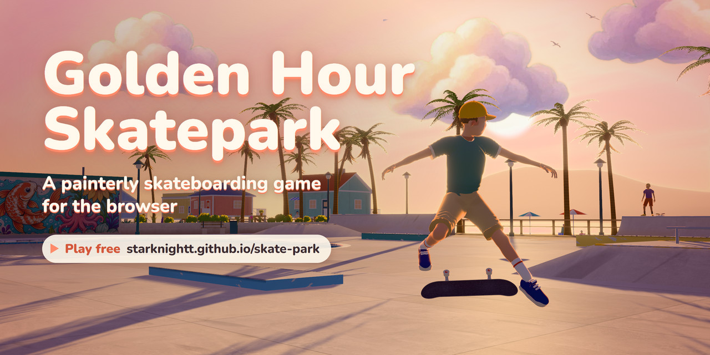
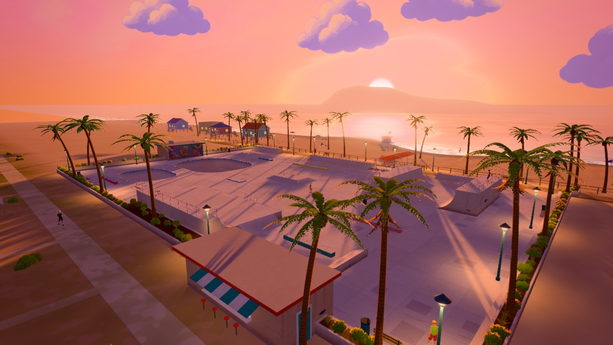
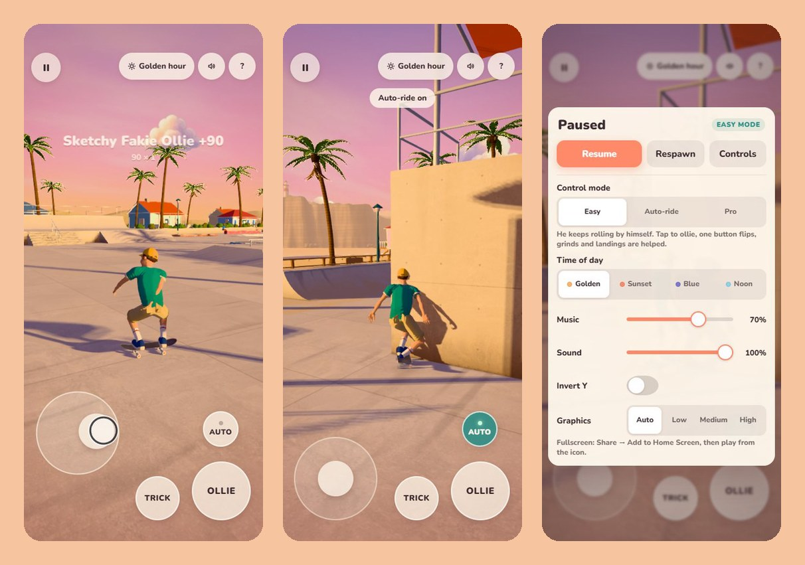
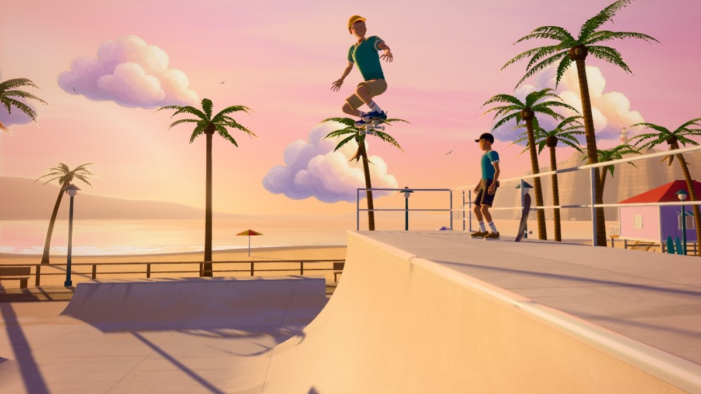
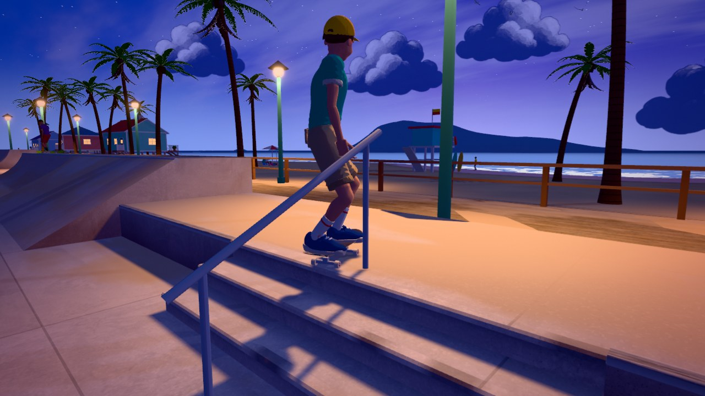
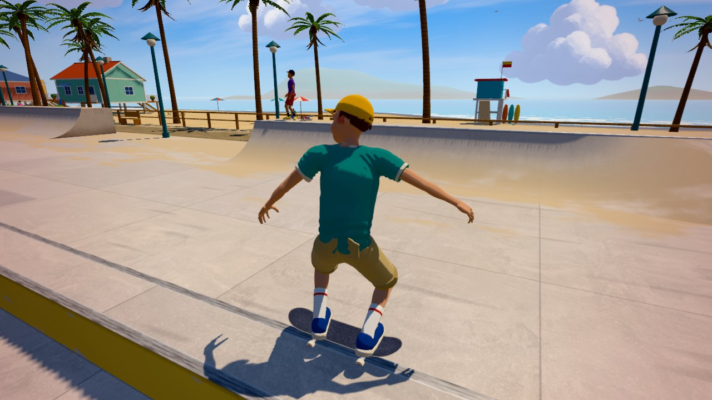
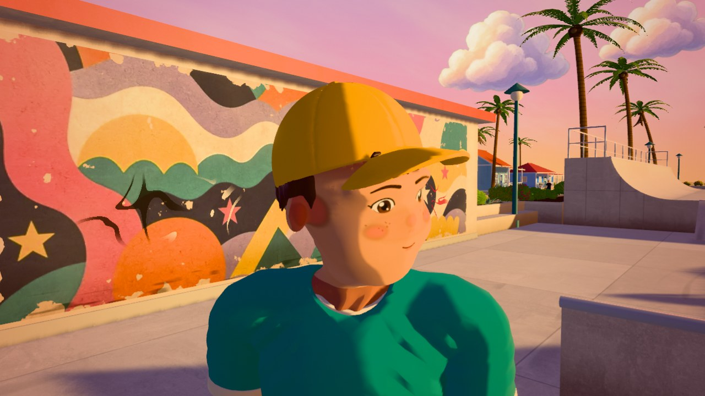

# Golden Hour Skatepark

A third-person skateboarding game for the browser, built in three.js. A small flow park sits behind a beach boardwalk
at golden hour, painted in a soft, warm, hand-made look, and you skate it as Sol, an original character: push and
carve, pump the transitions, drop in from the deck, ollie and flip, grind the rails and ledges, manual, bail and get
back up, then turn the sky to sunset, blue hour or noon. There are no levels, timers or goals; trick names and a combo
score pop up and fade, and that is all the game keeps. The park, the beach town around it and the board are built in
code, Sol's riding is animated procedurally, and everything in it is original: no real brands, logos or skaters appear
anywhere.



**Play it: https://starknightt.github.io/skate-park/**

**Code: https://github.com/StarKnightt/skate-park** · **How it was made: [docs/MAKING-OF.md](docs/MAKING-OF.md)**

It plays on a computer with a keyboard (the mouse and a gamepad are optional) and on phones and tablets with touch
controls. It was built in Chrome on Windows, on a PC with an RTX 4060 and a 200 Hz monitor; the phone version was
tested in Chrome's device emulation with a slowed-down CPU, not yet on a real phone. The first visit downloads about
1.9 MB before the game starts: on the live site, in Chrome's Fast 4G emulation with a four times slower CPU, it was
playable after 4.6 s with the Android profile and 6.1 s with the iPhone profile. The crowd and the sounds stream in
after that. On load Sol skates the park by himself behind the title card; press any key, click or tap to take over.

## Running it locally

```
git clone https://github.com/StarKnightt/skate-park.git
cd skate-park
pnpm install
pnpm dev          # http://127.0.0.1:5188/
pnpm build        # production build into dist/ (base /skate-park/)
pnpm preview      # serve dist/ on http://127.0.0.1:5189/skate-park/
pnpm typecheck    # tsc --noEmit
```

CI builds with Node.js 22, and `package.json` pins pnpm 10.18.0. The game is TypeScript built with Vite 8. The
runtime dependencies are `three` (0.186.1), `three-mesh-bvh` for the collision queries, `postprocessing` for bloom,
tone mapping and the grade, and the Nunito font from `@fontsource/nunito`. Both ports are fixed: if 5188 or 5189 is
taken, Vite stops with an error instead of picking another. `pnpm build` does not type-check, so run `pnpm typecheck`
first. The production build uses the base `/skate-park/` for GitHub Pages, which is why `pnpm preview` serves it under
that path. Every push to `main` builds the site and deploys it to GitHub Pages through `.github/workflows/deploy.yml`.



## Controls

There are three control modes, switched in the pause menu and remembered: **Easy** (the default on every device),
**Auto-ride** and **Pro**, described under [What is in it](#what-is-in-it). Nothing needs the arrow keys, and the
camera follows by itself, so the keyboard alone is enough.

| Input | Easy and Auto-ride | Pro |
|---|---|---|
| W | Faster; he keeps rolling at a cruise by himself | Push; held going downhill on a transition, pump |
| S | Slow down and stop | Brake |
| A D | Steer (a little softer); spin in the air | Steer and carve; spin in the air |
| Space | Tap to ollie (hold for a higher pop); in the air, a flip trick | Hold to crouch, release to ollie: the longer the crouch, the higher the pop |
| F | A flip trick, cycling kickflip, heelflip, pop shove-it and tre flip. Rolling, he crouches for a moment and pops it | A flip trick picked by the W A S D key you hold: none or A kickflip, D heelflip, S pop shove-it, W tre flip. Rolling: a short crouch, then the pop; crouched on Space: it pops at once at the current charge; in the air: a late flip |
| E | Grinds lock on by themselves near rails and ledges; E still works | Grind or slide a rail, ledge, curb or coping: a 50-50 when lined up with it, a boardslide when across it |

| Input | Action (every mode) |
|---|---|
| Shift | Manual; W and S keep the balance |
| Q | Auto-ride on or off |
| T | Next time of day: golden hour, sunset, blue hour, bright noon. Each change fades over about 2.6 s |
| R | Respawn |
| C | Recenter the camera |
| H or F1 | Help: the controls for every device and mode |
| Esc | Pause menu |
| Click | Lock the mouse for free look (raw mouse movement). Esc frees it and opens the pause menu |
| Mouse | Look around while it is locked; without the lock, drag to orbit the camera |

Roll off a deck toward the coping of a bowl, the half pipe or a quarter pipe and he drops in: the tail sets on the
coping, the nose comes up, then he leans in and the wheels meet the wall. Hold W as he reaches the lip of a steep wall
to air out onto the deck instead of turning back in.

The pause menu (Esc, gamepad Start, the touch pause button or the menu pill at the top right) freezes the game and
ducks the sound. It has Resume (which locks the mouse again if it was locked), Respawn, a Controls page for every
device and mode, the control mode, the time of day, music and sound volume, mouse sensitivity (0.2 to 3 times) and
invert-Y, the graphics level and fullscreen. In the menu W and S move, A and D change a setting, Enter or Space
selects and Esc resumes; on a gamepad the D-pad or left stick moves, A selects and B goes back.

### Gamepad

The standard mapping, with the face buttons named by position as A (bottom), B (right), X (left) and Y (top).

| Input | Easy and Auto-ride | Pro |
|---|---|---|
| Left stick | Steer; up faster, down slow down and stop | Steer; up push, down brake |
| A | Tap to ollie; in the air, a flip trick | Hold to crouch, release to ollie |
| X | A flip trick, cycling the four flips (rolling, it pops one) | A flip trick picked by the left stick: none or left kickflip, right heelflip, down shove-it, up tre flip |
| D-pad + A | | Hold a direction as you release A: the same flips |
| B | Grind (grinds also lock on by themselves) | Grind |

| Input | Action (every mode) |
|---|---|
| LB or RB | Manual |
| Y | Auto-ride on or off |
| Right stick | Camera (up to 180° a second); L3 or R3 recenters it |
| Start | Pause menu |
| Back | Respawn |
| LT | Next time of day |

### Touch

Phones and tablets get touch controls, in portrait or landscape. The sound starts with your first tap.

| Touch | Easy and Auto-ride | Pro |
|---|---|---|
| Stick | Put a thumb down anywhere in the lower left and the stick appears under it: steer; he keeps rolling, up for faster, down to slow down and stop | The same floating stick: up push, down brake, sideways steer |
| OLLIE | Tap to pop | Hold to crouch, release to pop; a short swipe as you let go picks a flip: left kickflip, right heelflip, down shove-it, up tre flip |
| TRICK | A flip trick, cycling the flips (rolling, it pops one) | |
| AUTO | Auto-ride on or off; lit while it drives | |
| GRIND | | Hold near a rail, ledge or coping |
| MANUAL | | Hold on flat ground |

In every mode, drag anywhere else to look around (a second finger in the stick area does too). The pause button sits
at the top left, and the time of day, sound and help pills at the top right. A swipe only counts if the thumb
travels 40 to 140 px in the last quarter of a second and is still moving when it lifts, so a drifting thumb gives a
plain ollie, and a system gesture (the notification shade, the app switcher) ends the crouch without a pop.

On Android, the browser's Install app (or Add to Home screen) plays it fullscreen from its own icon; on iPhone and
iPad, Share → Add to Home Screen does the same, and the pause menu shows that tip where the browser has no
fullscreen. The game pauses and goes quiet when you switch apps or lock the phone, and keeps the screen awake while
you ride or watch auto-ride. Portrait uses a wider camera; landscape shows the most.



The game also reads a few URL options:

| URL option | Effect |
|---|---|
| `mode=auto` | The control mode for this visit: `easy`, `auto` or `pro` (not saved) |
| `time=sunset` | Starts at another time of day. It matches the start of a preset's name: `golden`, `sunset`, `blue` or `bright` (noon) |
| `quality=1` | A fixed graphics level for this visit: `0` Low, `1` Medium, `2` High. It turns the adaptive quality off |
| `mobile` | The phone and tablet graphics tier, and its adaptation, on any device |
| `touch` | Touch controls on a computer |
| `mute` | No sound at all for this visit |
| `fps=30` | Caps the frame rate |
| `sens=1.5`, `invertY` | Mouse-look sensitivity (a multiplier from 0.1 to 4) and inverted Y for this visit |
| `test` or `debug` | The test API `window.__skate`: teleports, time of day, scripted input, frame stepping, camera views, state and an event log. Saved settings are ignored and nothing is saved, the control mode starts on Pro, there is no start screen and the adaptive quality is off. `test` also exposes `window.__pauseMenu` |
| `attract` | With `test` or `debug`, the start screen (the title card and the attract run) anyway |
| `nowarm` | Skips the load-time shader warm-up, for measuring it |

Join several with `&`, for example `?time=blue&mode=auto`. [docs/TESTING.md](docs/TESTING.md) describes the test API.

### Graphics quality

The pause menu's Graphics setting offers **Auto** (the default), **Low**, **Medium** and **High**. Auto starts phones
and tablets on Medium and computers on High, then adapts while you play. Every half second it looks at the 90th
percentile of the frame times over the last 6 s, and when frames miss a 60 Hz refresh (over 20 ms) it turns features
off first (bloom, then the sun-shadow refresh rate, then part of the crowd, then the lower levels), then lowers the
render scale (never below one rendered pixel per CSS pixel on phones), and only as a last resort caps the game at a
steady 30 fps. After 20 s with headroom it steps back up. It waits 5 s after the start, a resume or a return to the
tab before it judges. A level you pick yourself is remembered and turns the adaptation off.

| | Low | Medium | High |
|---|---|---|---|
| Pixel ratio | 1 | 1 to 1.25 | up to 1.75 |
| Sun shadows (two cascades) | 1024², 30 m, every 4th frame | 1024², 45 m, every 3rd frame | 2048², 95 m, every frame |
| Street lamps | the 4 nearest light pools | the 8 nearest light pools | all 21 pools, and a shadow-casting light in the nearest lamp |
| Sol's own shadow map | 256² | 512² | 1024² |
| Bloom | off | off | on |
| Anti-aliasing | none | FXAA | 4x MSAA |
| Crowd | 6 people, simplified sooner, no shadows | 10 people, simplified sooner, no shadows | everyone, with shadows |
| Bushes | 30 % of the leaf clumps | 50 % | all |

Low and Medium also use a lighter shader path (four shadow taps, one cascade per pixel) and a simpler sky and sea.

## What is in it

- **The park.** Two pool bowls sunk into the plaza (the main one 18 by 14 m and 2.3 m deep, with a tile band and
  chunky pool coping, and a 1.4 m pocket bowl), a 3 m half pipe with a little vert, quarter pipes, 30° banks and a
  moulded hip, a terrace with a six-stair and a handrail, a funbox with angle-iron edges and a flat bar, painted
  ledges, a curb, a manual pad, a flat rail, a pyramid and a platform with a three-stair and rail, joined into lines.
  The edges are seat steps, planters and benches, and three murals cover the outer wall of the half pipe, a small
  pavilion and the snack kiosk.
- **Sol.** An original skater in a cap, a tee and shorts, with painted freckles and five expressions (neutral,
  focused, wide-eyed, a grin and a grimace). His riding is procedural: his feet are pinned to the deck by two-bone IK,
  the knees stay over the toes, and the cloth folds and flutters. Falls, get-ups and idles are motion clips.
- **Skating that keeps its momentum.** Pushes give less the faster you go, transitions turn height into speed and
  back, uphill costs speed, and carving keeps it. He kickturns at the top of a wall, forward or fakie, airs out of
  steep walls, drops in from the deck with the tail on the coping, and pumps the half pipe up to the lip.
- **Tricks.** Ollies, kickflips, heelflips, pop shove-its and tre flips, spins, late flips, 50-50s and boardslides on
  every rail, ledge and coping, and manuals. Landings are judged on the board's angle, the heading against the travel
  (fakie is fine) and whether the flip was caught: slightly off is a sketchy wobble, badly off is a bail. Trick names
  and a combo score pop up and fade, and tricks chain into a combo until you ride a second without one.
- **Bails.** Wall hits and bad landings knock him down; the board tumbles away and comes to rest on its own, and he
  gets up on level ground (never on a bowl wall) and walks back to it.
- **Three control modes.** **Easy** keeps him rolling at a comfortable cruise, makes the steering softer, pops a good
  ollie from a tap, flips with one button, locks grinds on by itself, straightens landings and keeps bails short.
  **Auto-ride** has him skate the park on his own through hand-made lines (the bowls, the half pipe with vert airs,
  the ledges, rails, funbox and manual pad, with varied tricks); any movement or trick input takes over at once, and
  about 4 s after you let go he carries on. **Pro** is the full manual scheme. The start screen is the auto-ride on a
  calmer lap under the title.
- **Four times of day.** Golden hour (the default), sunset, blue hour and bright noon, each a full lighting preset that
  T fades between. At sunset and blue hour the street lamps throw warm pools of light, the windows and the kiosk
  glow, and at blue hour the stars come out.
- **The beach around it.** The boardwalk with its lamps and benches, beach houses, a headland with a lighthouse, palms
  that sway, gulls, umbrellas and a lifeguard tower, a snack kiosk with a vendor, and fifteen people: skaters waiting
  on the decks, friends on the seat steps, walkers on the boardwalk and the beach, a couple on the sand and the
  lifeguard.
- **Sound.** Wheel rolls on concrete and on the wooden boardwalk that follow the speed, pops, landings, board clacks,
  metal and concrete grinds, waves, gulls and a gentle ukulele loop.
- **Phones and tablets.** Touch controls for every mode, a lighter graphics tier that adapts to the device, an
  installable web app, a pause when the page is hidden and a screen that stays awake while you play.



## How it works

### The look

The materials are three.js Lambert materials with a toon pass patched into their shaders: wrapped, softly banded
light, a sky ambient that knows where the sun is, a backlight rim, procedural concrete wear and pores, and warm light
pools from every street lamp, computed in the shader. The sun casts two cascades of soft, filtered shadows, and Sol
gets a shadow map of his own a few millimetres per texel across, so his shadow on the ground and the walls keeps his
shape. The sky is a painted gradient dome with brushy cirrus, the clouds are painted billboards, and the sea is a
stylised shader with a glitter path. Bloom, tone mapping, a warm grade with a vignette and FXAA (or MSAA) finish the
frame. The four times of day are presets of about forty values each, blended over 2.6 s.

### The park and its collision

The park is built in code, and the same triangles that are drawn are the collision surface: one mesh with smooth
normals in a bounding volume hierarchy (`three-mesh-bvh`), which the physics raycasts every step. Rails, ledges and
copings are polylines the grinds run along. Invisible fences behind the visible railings keep him in without ever
bailing him.

### The physics

Sol is a kinematic skateboard controller stepped at a fixed 120 Hz: slope gravity, rolling resistance, sine-shaped
push strokes, steering limited by grip and helped by the bank of a wall, pumping, kickturns, ballistic airs with a
vert assist that turns him round over the ramp, and a landing prediction that lines the board up with the ground.
Every visual layer draws the state interpolated between the last two physics steps, with smooth (Hermite) arcs in
the air, so the motion is equally smooth at 60, 144 or 200 Hz. Without that, a 200 Hz monitor showed him moving 0 mm,
then 47 mm, then 0 mm from frame to frame.

### Sol

Sol was modelled by a script: a Python modeller builds every body and clothing part as a signed distance field fitted
to the Mixamo reference skeleton, and a Blender script rigs, weights and exports him with the clips he uses. His riding
pose is computed every frame from the physics (crouch, pop, flick, tuck, absorb, push, carve lean, kickturn, manual
balance, grinds), with two-bone IK pinning his feet to the deck. Mixamo clips play only for falls, get-ups and idles.

### Auto-ride

The autopilot only produces input, exactly as a player would: it steers by pure pursuit along hand-made lines, manages
its speed, pumps, and fires ollies, flips, grinds, manuals and half-pipe airs at marked points. In the headless sims
on the final physics it rode every lap clean, nine of nine in each of the assisted, Pro and attract settings.

The details are in [docs/ARCHITECTURE.md](docs/ARCHITECTURE.md).



## Performance

On the development PC (RTX 4060, 200 Hz monitor, High), the real-time test runs held the monitor's 200 Hz: a median
frame of 5.00 ms that varied by 0.06 to 0.07 ms, in an 880 by 640 window. Every scenario of the vibration protocol
passed in its final runs, at 200 Hz and in a 60 Hz sweep (see [docs/TESTING.md](docs/TESTING.md)).

On phones it was measured in Chrome's emulation with a four times slower CPU and a 60 Hz refresh: 58.5 to 59.9 fps on
average, 0.1 to 2.4 % of frames over 20 ms and at most 13.1 ms of main-thread time per frame at the 95th percentile;
at six times slower, 46.3 fps. Medium draws 105 draw calls and 561,000 triangles a frame. These numbers come from the
helpers' builds of the final code; the GPU time of a real phone is still unmeasured.

The JavaScript is 1.22 MB (350 KB compressed). Sol's model with his clips is 854 KB (537 KB compressed), the crowd's
clips and detail levels 494 KB, the textures 755 KB, and the sounds 0.73 MB plus 2.2 MB of streamed music. The sounds
load after the first tap; on the live site they were all decoded within 1.5 s of it.

## Project structure

```
src/
  main.ts, game.ts  entry; the game loop, fixed-step physics, interpolated view, warm-up, quality adaptation
  core/             input (keyboard, mouse, gamepad, touch), settings, device facts, page lifecycle, springs
  player/           physics, Sol's animation, the board, the camera rig, bail recovery, autopilot and its lines, tricks
  world/            the park and its collision, park detail, the beach and town, foliage, the crowd
  render/           toon materials, sky, clouds and sea, times of day, post, Sol's shadow map, quality tiers
  ui/               HUD, touch controls, pause menu, CSS
  audio/            the Web Audio engine
  debug/            the window.__skate test API
public/             skater.glb and people.glb, textures, sounds, app icons, the web app manifest, og-image.jpg
assets_src/         the generated artwork and CC0 texture sources the shipped textures were made from
tools/              character and asset pipelines, the capture harness, the real-time protocol, headless sims,
                    the mobile QA protocol, the heavy-job lock
docs/               ARCHITECTURE.md, MAKING-OF.md, TESTING.md and the screenshots in media/
```



## Limitations

- **Phones are untested on real devices.** The touch controls, the phone tier and the load path were tested in
  Chrome's emulation on a desktop GPU. Audio unlock on iPhone Safari and its recovery after a call, the screen wake
  lock, real safe areas, the thumb feel of the floating stick and the swipe window, a phone's GPU time, its first
  shader compile and thermal throttling over a long session all still need a real phone.
- **The full mobile protocol was not rerun on the final build.** Its 62 passes come from the helpers' builds of the
  same code; on the live build only the load test ran.
- **Pointer lock has not been tried with a physical mouse.** The test agents emulated it, so that their windows
  never took the user's cursor; one minute with a real mouse is still owed.
- **Small open polish items from the last review.** On phones the title card crosses Sol for the first seconds, and
  in landscape it runs into the flip hint. In auto-ride, catching a coping grind brings his body upright in about
  0.1 s, and a short air that lands on the deck does so in about five frames. Switched on behind the south-east
  ledge, auto-ride nearly stops for about 3.5 s before it sets off. Close up, one beach walker's blonde fringe shows
  pale saw-teeth.
- **Recovery.** In Pro, a board that stops at the foot of a bowl wall can hop to flat ground while he gets up. In Easy
  he now walks to the board, so getting back on takes 3 to 4 s instead of under 2.
- **Tricks.** There are no grabs, and vert airs turn 180° by themselves.
- **Mobile tier leftovers.** The crowd's face texture is not yet reduced on phones, Low keeps both sun cascades
  (three.js fixes their number), Sol's model is 854 KB against an 800 KB goal, and the music streams at its original
  2.2 MB. Its loop, now streamed, may have a tiny gap at the wrap (every 98 s) on some browsers.
- **Browsers.** Built and tested in Chrome on Windows; Firefox and desktop Safari are untested.

## How it was built

It was built in Cursor by AI agents in about 28 hours, over five builder and critic passes. A builder implemented each
pass, and a separate critic, which saw only screenshots and recordings of the running game, compared them with real
photographs of beachside skateparks at golden hour and real skateboarding footage and listed everything that looked
fake. Pass 1 had 54 issues; the pass-5 verdict was a pass with no breaks and nothing noticeable. Along the way a
real-time diagnosis fixed the skater's vibration, a mobile QA pass turned it into a phone game, and the user's own
play-test reshaped the controls, all through an overnight run and two power cuts. The story, with the numbers, is in
[docs/MAKING-OF.md](docs/MAKING-OF.md); the architecture is in [docs/ARCHITECTURE.md](docs/ARCHITECTURE.md), and the
test hooks, protocols and how to rerun them are in [docs/TESTING.md](docs/TESTING.md).



## Licence and credits

Everything in the game is original: the park, the skater Sol, the board and its graphic, the murals, the app icons and
the UI. There are no real brands or logos, no real pro skaters and no references to existing games. The real
photographs and footage the critic compared against were used for comparison only and are not in this repository.

The repository has no licence file yet, so the game's own code and artwork carry no open-source licence for now. The
third-party assets keep their own licences, listed below.

### Sounds (all CC0 1.0, from [freesound.org](https://freesound.org))

| File | Sound | Author | Source |
|---|---|---|---|
| roll_concrete.mp3 | BPS-SKATEBOARDING RIDING-Concrete Skatepark-Transition-Cruising | bspiller5 | https://freesound.org/people/bspiller5/sounds/478162/ |
| roll_wood.mp3 | Rolling Wheels 2 | CJspellsfish | https://freesound.org/people/CJspellsfish/sounds/727643/ |
| grind_metal.mp3 | Skateboard Metal Grinding.1 | rokenjocu | https://freesound.org/people/rokenjocu/sounds/262079/ |
| grind_concrete.mp3 | skateboard grinding on concreate slab | 21100495 | https://freesound.org/people/21100495/sounds/655372/ |
| pop.mp3 | popping up skateboard | nolimitkid | https://freesound.org/people/nolimitkid/sounds/515226/ |
| land.mp3 | BPS-SKATEBOARDING GRINDS-Slides-Concrete Ledge-Multiple Lands-1 | bspiller5 | https://freesound.org/people/bspiller5/sounds/478164/ |
| clack.mp3 | Longboard hitting the ground | gerardcatala | https://freesound.org/people/gerardcatala/sounds/153285/ |
| waves.mp3 | WavesOnTheShore | richardemoore | https://freesound.org/people/richardemoore/sounds/260263/ |
| seagulls.mp3 | Seagull on beach | squashy555 | https://freesound.org/people/squashy555/sounds/353416/ |
| music.mp3 | ukulele | _steef | https://freesound.org/people/_steef/sounds/173122/ |
| bail_thud.mp3 | Body fall_02 | deleted_user_2104797 | https://freesound.org/people/deleted_user_2104797/sounds/346694/ |

Since pass 5 the shipped files (except music.mp3) are trimmed to the parts the game plays and re-encoded (mostly mono),
by `tools/assets/audio_trim.sh` from the originals above.

### Textures

| Asset | Author | Source | Licence |
|---|---|---|---|
| Concrete 034 (detail map for the concrete) | ambientCG / Lennart Demes | https://ambientcg.com/view?id=Concrete034 | CC0 1.0 |
| Planks 029 L (boardwalk planks) | ambientCG / Lennart Demes | https://ambientcg.com/view?id=Planks029L | CC0 1.0 |

### Generated for this project (original artwork, Cursor image generation)

The skater concept turnaround (`assets_src/generated/skater_concept_turnaround.jpg`), the three murals ("sun and
waves", "koi and octopus", "tropical patchwork"), the deck graphic (sun, waves and a paper boat) and the painted cumulus
clouds sheet (chroma-keyed into `public/textures/clouds.webp`). The skater's five face expressions (neutral, focused,
wide-eyed, grin, grimace) are painted procedurally by `tools/character/paint_face.py`. All other geometry (park,
scenery, houses, palms, board, skater) is generated in code.

### Animation

Fall, get-up, idle and balance clips from [Mixamo](https://www.mixamo.com) (Adobe), used under the Mixamo licence and
shipped only baked into `public/models/skater.glb`: Falling Flat On Face, Slip And Fall Backwards, Knocked Over And
Falling To The Ground, Mid Air Falling Into A Roll, Frantically Slip And Fall To Stomach, Falling In The Air Idle,
Getting Up From Stomach, Getting Up From Back, Getting Up From Being Knocked Down, Standing Idle, Wobbling On A Ledge,
Slipping Off An Edge Then Regaining Balance, Standard Walk, Male Knocked Down From A Punch (wall impact), Laying On A
Bed Shrugging (re-baked to the floor as the post-bail shake-off), Weight Shift Idle, Idle Stand Looking Around. The
park's people (`public/models/people.glb`, recoloured variants of the same original character) use Sitting With
Breathing Idle, Sitting While Laughing, Sitting Reclined On The Floor, Standing Texting On Phone, AJ Waving Gesture and
Sitting Unenthusiastic Clap. The rig is the standard Mixamo skeleton (reference "Bryce"); no Mixamo character mesh is
used. Raw FBX files are not part of this repository.

The pass-3 additions (the drop-in, a dedicated high-resolution shadow for the skater, painted leaf-clump foliage, the
lit kiosk interior, the charcoal grip texture) are all generated in code; no new third-party assets were added. Since
pass 5 `skater.glb` carries only the clips the game plays (the stomach fall, air flail, knocked-down get-up, ledge
wobble, regain-balance and relaxed idle were dropped), and the crowd reuses the skater's mesh, so `people.glb` holds
only the crowd's clips and its baked detail levels.

### App icons and images

`public/icons/*` (home-screen and install icons) are original artwork drawn by `tools/assets/make_icons.py` for this
project; no third-party assets. The social preview image (`public/og-image.jpg`) and the screenshots in `docs/media/`
are renders of the game itself; the preview's title is set in Nunito.

### Libraries and tools

three.js (MIT) · three-mesh-bvh (MIT) · postprocessing (Zlib) · Vite (MIT) · TypeScript (Apache-2.0) · glTF-Transform
(MIT) · meshoptimizer decoder + simplifier (MIT; the simplifier bakes the crowd's detail levels offline) · Nunito font
via @fontsource (SIL OFL 1.1) · Blender (GPL, build tool only) · NumPy, SciPy, scikit-image, Pillow (build tools only)
· Playwright (capture tool only).

### Skills consulted

cloudai-x/threejs-skills, dgreenheck/webgpu-claude-skill, majidmanzarpour/threejs-game-skills and skills from skills.sh.
